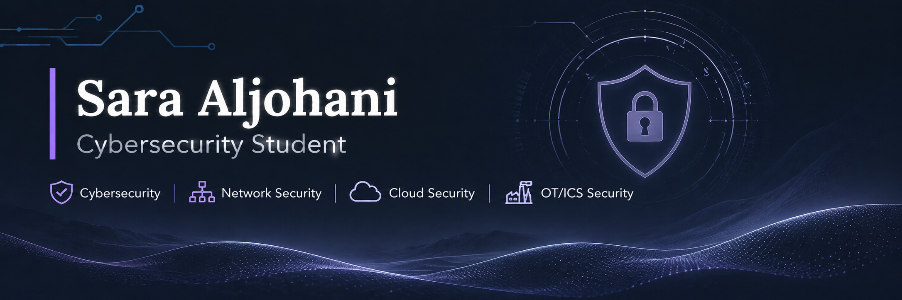

---

# 👋 Hi, I'm Sara Aljohani

### Cybersecurity Student | Networks & Security | Cloud Security

🎓 Diploma in Cybersecurity  
🎓 Bachelor's Student in Networks & Security

I'm a cybersecurity enthusiast passionate about network security, cloud computing, security operations, and industrial cybersecurity.

I enjoy exploring emerging technologies, developing practical skills, and building projects that contribute to a safer digital environment.

---

## 🛡️ Areas of Interest

- Cybersecurity
- Network Security
- SOC Analysis & Incident Response
- Cloud Security
- OT/ICS Cybersecurity
- AI in Cybersecurity
- Critical Infrastructure Protection

---

## 💻 Technical Skills

- Networking & Network Security
- Cisco Packet Tracer
- Python
- Linux
- Cybersecurity Fundamentals
- Machine Learning Fundamentals
- Cloud Computing Fundamentals

---

## 🎓 Certifications & Training

- CompTIA Security+ — Certification
- Introduction to Critical Infrastructure Protection (ICIP) — OPSWAT Academy
- AWS Certified Cloud Practitioner — Learning Path Completion
- SOC Analyst Level 1 — Professional Training
- Cisco Networking Academy Courses

---

## 📚 Current Learning

- CCNA Preparation
- Network Security
- Cloud Security
- OT/ICS Security
- Security Operations & Incident Response

---

## 🚀 Featured Projects

### 🔹 Secure Network Design
Secure network architecture and simulation using Cisco Packet Tracer, including VLANs, DMZ, firewall, and network segmentation.

### 🔹 ReliQ – Interactive Learning Platform
An educational platform designed to help students explore Moon and Mars rovers through interactive maps, 3D models, AI chatbot, and missions.

### 🔹 AI Financial Fraud Detection
An AI-powered financial fraud detection project using Python and Random Forest.

---

## 🎯 Professional Goals

- Develop advanced networking and cybersecurity skills.
- Gain practical experience in SOC operations.
- Explore cloud security technologies.
- Specialize in OT/ICS cybersecurity.
- Contribute to protecting critical infrastructure.

---

## 📫 Connect With Me

- **LinkedIn:** [Sara Aljohani](https://www.linkedin.com/in/sara-aljohani-b83b4331b/)
- **GitHub:** [@xSarah11](https://github.com/xSarah11)

---
## 📊 GitHub Activity

Explore my repositories, projects, and coding contributions.

- 🔹 Network Security Projects
- 🔹 Python & AI Projects
- 🔹 Cybersecurity Projects
- 🔹 Cloud & OT/ICS Interests

[View My GitHub Repositories](https://github.com/xSarah11?tab=repositories)

---

## 🌐 Let's Connect

Feel free to explore my repositories and connect with me!
⭐ Always Learning | Always Building | Always Securing

